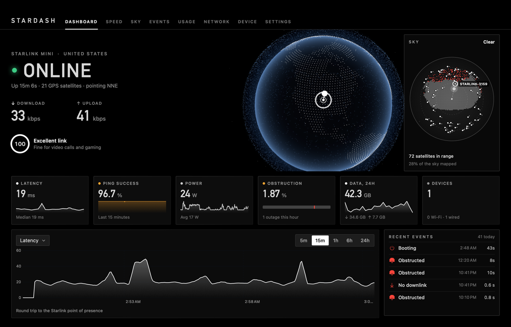
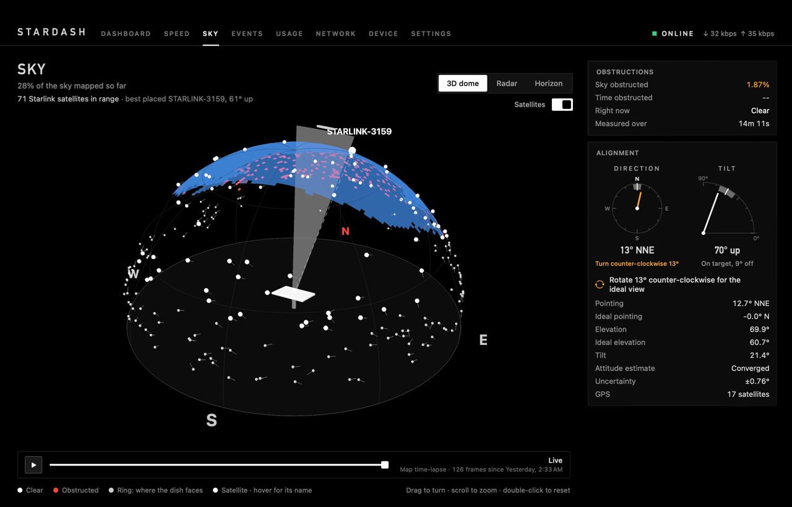
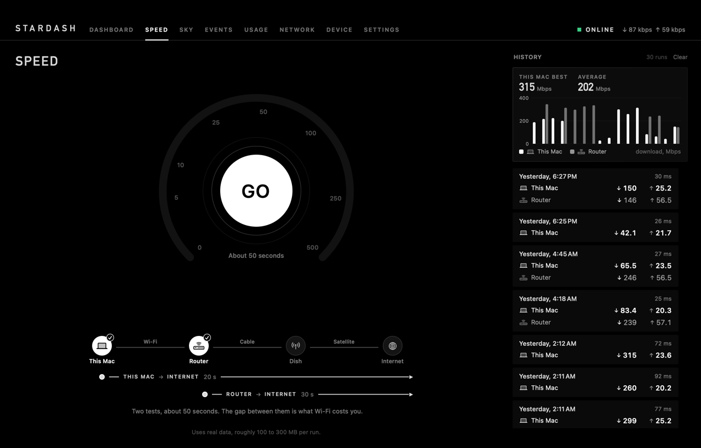
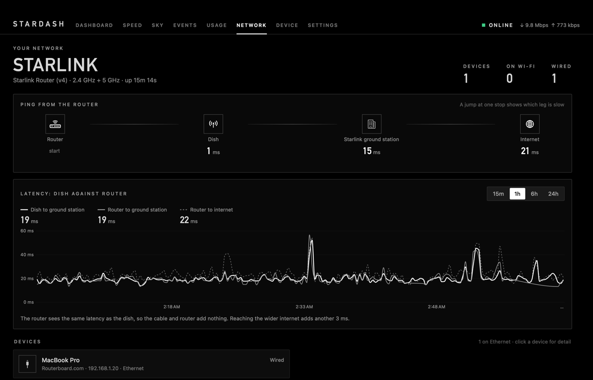
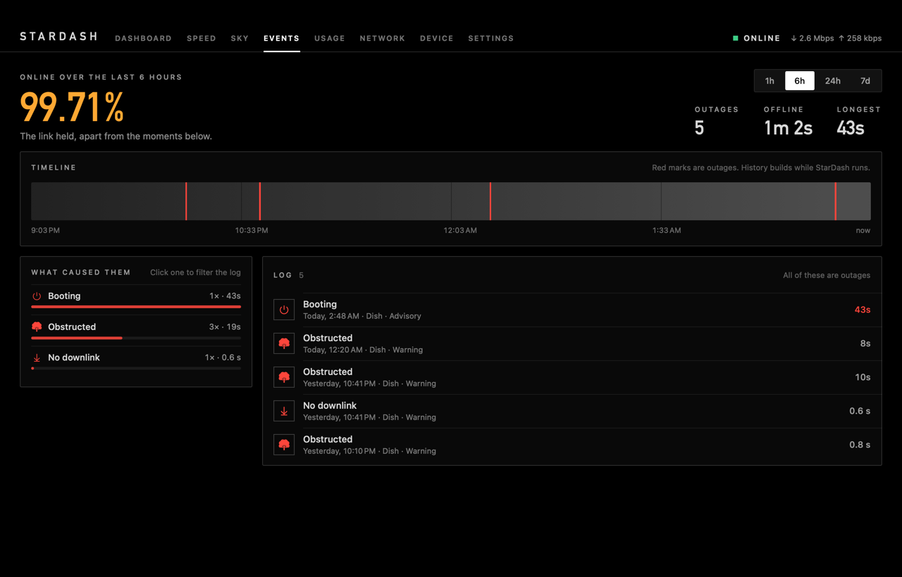
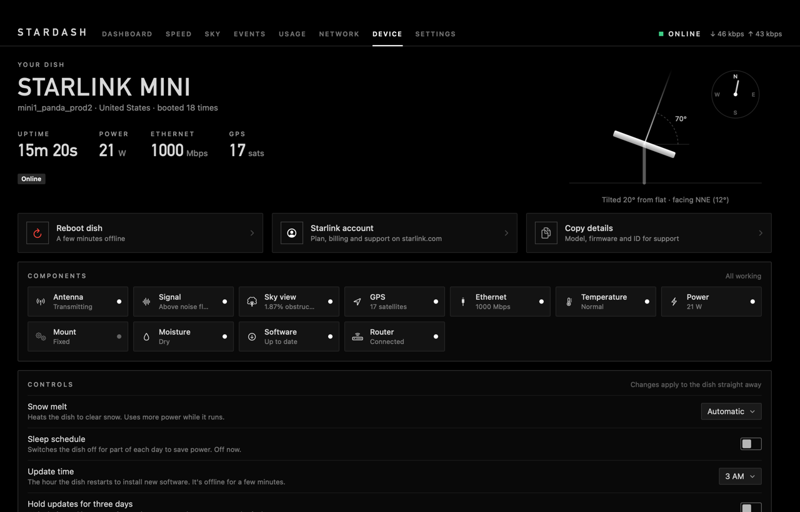

# StarDash

A native macOS monitor for Starlink. It lives in the menu bar and talks to your dish and router
over the local network, so nothing leaves your Mac and no Starlink account is needed.



## What it shows

- Live throughput, latency, packet loss and power draw in the menu bar, with a one-screen popover.
- The dish's obstruction map as a flat chart, a horizon view and a 3D dome, with a time-lapse of how it filled in.
- The Starlink satellites overhead right now, computed from public orbit data, and the one the dish is most likely using.
- Outages and alerts over time, including ones the dish has already forgotten.
- Every device on the Wi-Fi with its vendor, signal and traffic, plus mesh nodes.
- Speed tests from the Mac and from the router, with packet loss.
- Dish settings: snow melt, sleep schedule, update time, obstruction map reset, stow and reboot.

## Screenshots

| Sky | Speed |
| --- | --- |
|  |  |
| **Network** | **Events** |
|  |  |
| **Device** | |
|  | |

## Requirements

macOS 14 or later, on the same network as a Starlink dish. The default addresses
(`192.168.100.1` for the dish, `192.168.1.1` for the router) can be changed in Settings.

## Install

Download the latest `.dmg` from [Releases](../../releases), open it and drag StarDash to Applications.
Releases are signed and notarized.

## Build from source

Needs Xcode 26 or later.

```sh
./scripts/bundle.sh       # builds dist/StarDash.app
./scripts/dmg.sh          # optional: packs it into a disk image
open dist/StarDash.app
```

`swift build` alone builds the binary without the app bundle.

To retake the screenshots without your own details in them (country, Wi-Fi name, device names,
location), launch with `--demo`. Nothing is saved while it's on.

## Contributing

Pull requests are welcome. CI builds every pull request; the first run from a new contributor waits
for a maintainer to approve it. Maintainers: see [docs/RELEASING.md](docs/RELEASING.md).

## Disclaimer

StarDash is independent and not affiliated with Starlink or SpaceX. Changing dish settings goes
through the same local API the official app uses, at your own risk.

## License

MIT
